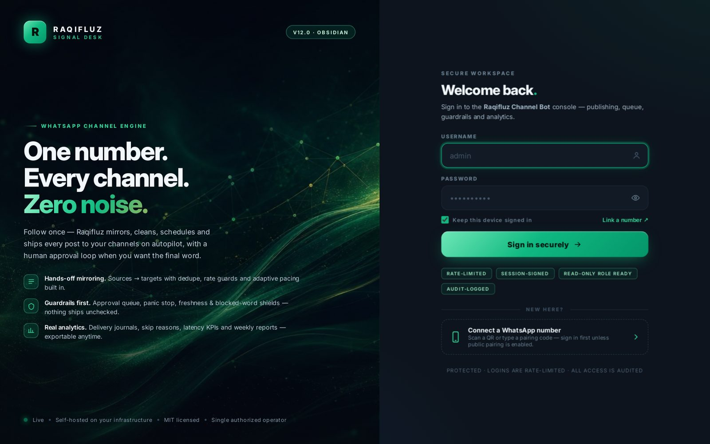
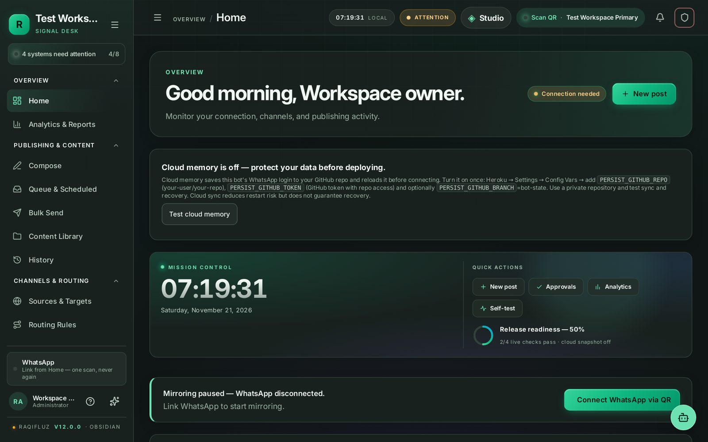
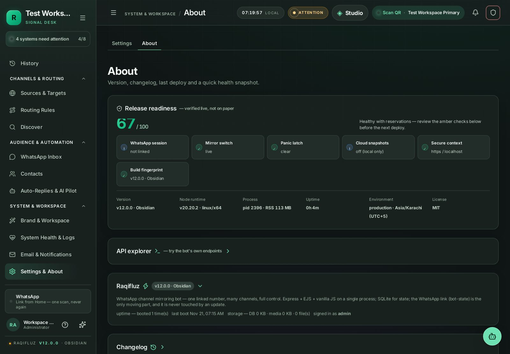
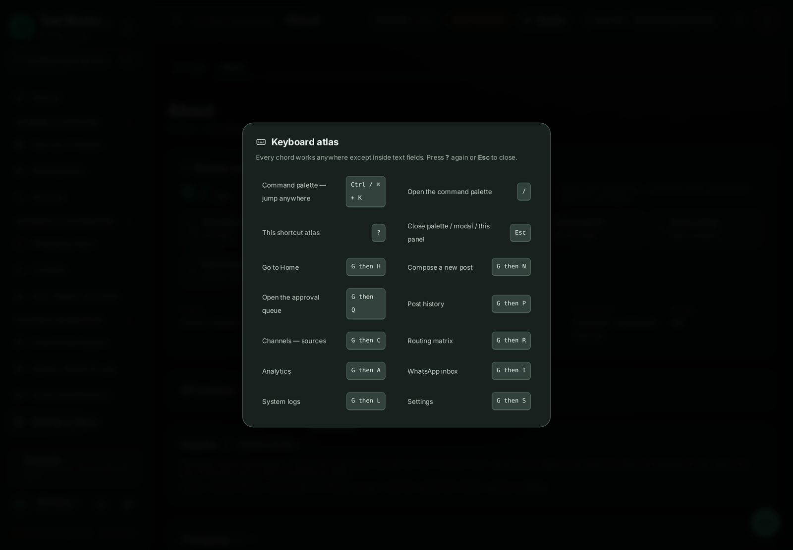
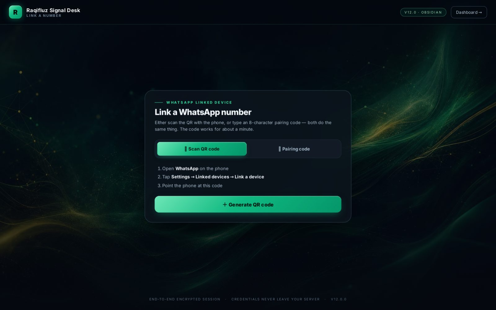
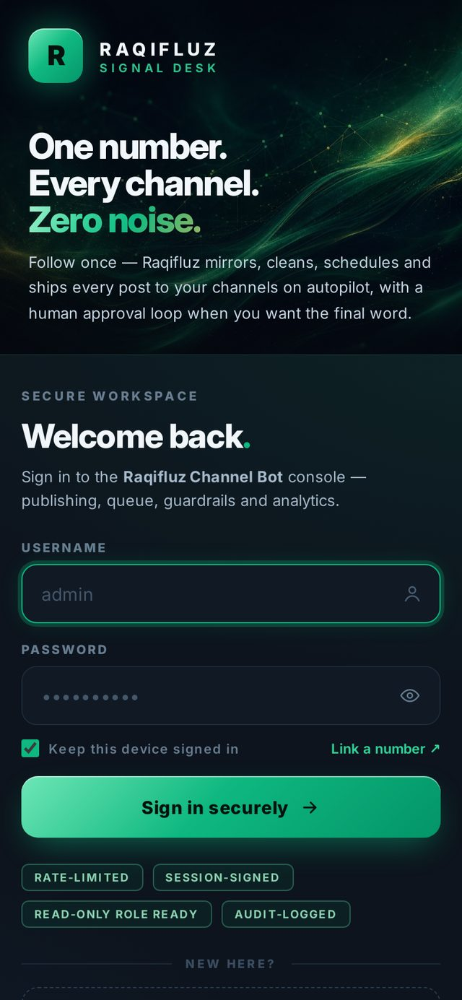

# Raqifluz Channel Bot — v12.0.0 “Obsidian”

A WhatsApp **channel mirroring console**: follow channels once, and Raqifluz mirrors, cleans, schedules and ships every post to your targets — hands-off, or with a human approval loop. v12 is the **premium overhaul**: a rebuilt sign-in experience, a frosted command deck, mission control on Home, and a repository that finally looks as serious as the code inside it.

> Single-workspace, single-dyno application. The WhatsApp link uses an unofficial linked-device library (Baileys), not the Meta Cloud API. Treat it accordingly, and use a test account first.

## Visual tour

| | |
| --- | --- |
| **Split-screen sign-in** — living aurora artwork, proof points, hardened form | **Mission Control home** — live clock, quick actions, readiness ring |
|  |  |
| **Release readiness** — six live checks, fingerprinted build | **Keyboard atlas** — `?` anywhere, G-chords throughout |
|  |  |
| **Link a number** — QR or pairing code, same flow as WhatsApp | **Mobile** — fully responsive, `< 640 px` bottom bar |
|  |  |

---

## What's new in 12.0 “Obsidian”

**Experience**
- 🌌 **Split-screen sign-in** — living aurora artwork, feature proof points, show/hide password, loading state, security chips. The `/connect` pairing page got the same treatment (QR + pairing code, fully keyboard accessible).
- 🛰️ **Mission Control on Home** — live local clock, large date, one-tap quick actions (New post · Approvals · Analytics · Self-test) and a **release-readiness ring** computed from real `/api/overview` state.
- 🎛️ **Frosted command deck** — blurred top bar with a gradient hairline, live clock chip, and a **system status pill** (`ALL SYSTEMS GO` / `ATTENTION` / `DEGRADED`) refreshed every 20 s from real state.
- 🔢 **KPI count-up numerals**, gradient numerals, hover lift on cards, light-sweep primary buttons, sliding highlight + icon micro-motion in the sidebar, breathing status dots, sliding-hatch panic banner.
- 🎉 **Confetti** — a small side-cannon pair fires only on genuine successes (sent / published / queued / saved / restored…). Respects `prefers-reduced-motion`.
- ⌨️ **“?” keyboard atlas** — every shortcut on one cheat sheet, plus **G-chords** (`G H` home · `G N` compose · `G Q` queue · `G P` history · `G C` channels · `G R` routing · `G A` analytics · `G I` inbox · `G L` logs · `G S` settings).
- 📱 **PWA install pill** — appears only when the browser offers installation; offline shell updated (SW v4 caches the new assets + artwork).

**Trust & platform**
- 🛡️ New **`/api/meta`** build/runtime fingerprint (version, codename, node, pid, RSS, uptime, environment) — powers the About **Release readiness** card, computed live: WhatsApp session · mirror switch · panic latch · cloud snapshots · secure context · build fingerprint.
- 🔒 Additional **security headers**: `Permissions-Policy`, `Cross-Origin-Opener-Policy`, `Origin-Agent-Cluster` (joining the existing `nosniff`, `Referrer-Policy`, `X-Frame-Options` + cross-origin mutation guard).
- 📦 **Repository, organized** — docs moved to `docs/`, scratch/build tooling to `tools/`, CI workflow, `LICENSE` (MIT), `SECURITY.md`, `CONTRIBUTING.md`, this README. Runtime junk (`data/`, `logs/`, `media/`, `backups/`) stays out of the distribution.

**Unchanged on purpose**
- The mirroring pipeline, queue, approval flow, pacing controller, panic stop, GitHub cloud snapshots, SQLite schema, session store and every existing API route behave exactly as in v11.5. Schema changes: none. Destructive steps: none.

---

## Quick start (local)

```bash
npm ci
cp .env.example .env       # set DASHBOARD_USERNAME / DASHBOARD_PASSWORD / SESSION_SECRET
npm test
npm start                  # http://localhost:20249
```

## Deploy to Heroku (existing repo)

1. Keep your Config Vars (`DASHBOARD_USERNAME`, `DASHBOARD_PASSWORD`, `SESSION_SECRET`, optional `PERSIST_GITHUB_*`). Do **not** reset the database or the state branch.
2. Replace the repo contents with this release (or upload the zip over it), commit, push — GitHub integration deploys automatically; Node 24 buildpack installs from `package-lock.json`.
3. One web dyno only (`heroku ps:scale web=1`). Schema is additive — nothing to migrate.
4. Sign in → Home shows **Mission Control**; check the **Release readiness** card under About; watch the top-bar pill go green.

Full runbook, upgrade steps and hard limits: **[README-HEROKU.txt](README-HEROKU.txt)** → see also **[RELEASE-12.0.md](docs/RELEASE-12.0.md)** and **[READ-ME-FIRST.md](READ-ME-FIRST.md)**.

## Keyboard atlas

| Key | Action |
| --- | --- |
| `Ctrl/⌘ K` or `/` | Command palette — jump anywhere |
| `?` | This shortcut sheet |
| `Esc` | Close palette / modal / sheet |
| `G` then `H/N/Q/P/C/R/A/I/L/S` | Home · Compose · Queue · History · Channels · Routing · Analytics · Inbox · Logs · Settings |

## Repository layout

```
src/                 application source (Express + EJS + vanilla JS, Baileys, better-sqlite3)
  web/views/         EJS screens (dashboard · login · connect)
  web/assets/        CSS/JS/icons/fonts/PWA (+ brand/aurora.jpg artwork)
tests/               integration suite (npm test)
test/                legacy regression harnesses
tools/               dev scratch scripts & the CSS build kit (not needed at runtime)
docs/                historical BUILD-PLAN / FINAL-REPORT / RESKIN_NOTES / release notes
Procfile             Heroku entry  ·  Dockerfile · compose.yaml · .github/workflows/ci.yml
```

## Honest fine print

- WhatsApp channel automation rides an unofficial library. Availability, limits and policies can change without notice. Use a test number first.
- GitHub snapshots are best-effort, not a transactional store. Keep your own backups (Settings → Data & recovery).
- One dyno, one workspace. Not multi-tenant SaaS, not HA. Heroku restarts can drop recent unsynced state.
- “Release readiness” verifies live checks on **your** deployment — it is a report, not a certificate.

## License

MIT — see [LICENSE](LICENSE).
